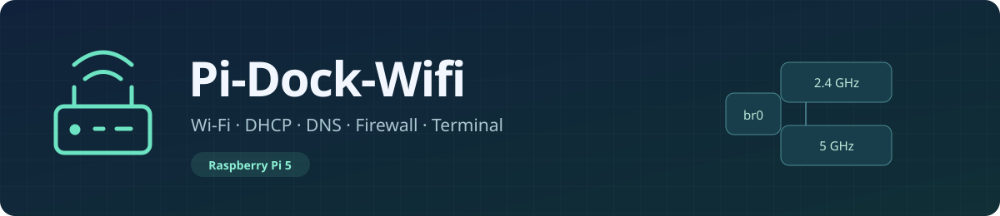
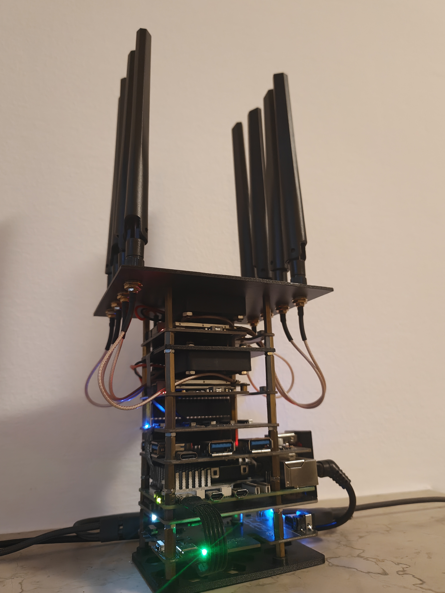
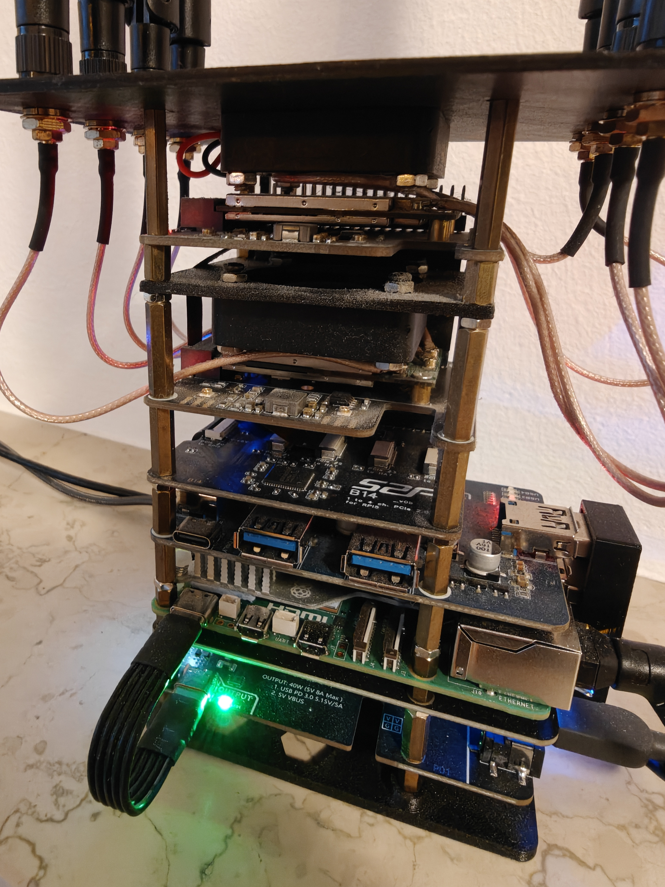
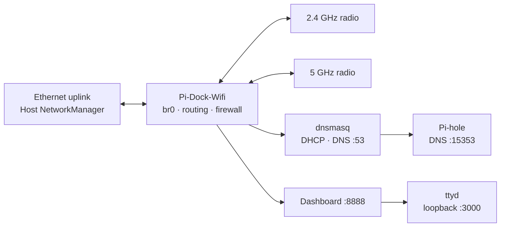

<p align="center">
  
</p>

<p align="center">
  <a href="README.md">Italiano</a> · <strong>English</strong><br>
  <a href="docs/en/GUIDE.md">Installation</a> · <a href="docs/en/HARDWARE.md">Hardware</a> · <a href="docs/en/NETWORK.md">DHCP and firewall</a>
</p>

# Pi-Dock-Wifi

**A Raspberry Pi 5 router with open configuration and direct control of your network.** Two Wi-Fi radios, DHCP/DNS, Pi-hole filtering and an SSH terminal, managed with Docker Compose.

`Raspberry Pi 5` · `Linux ARM64` · `Docker Compose` · `Italiano / English`

## Assembled router

<p align="center">
  <a href="docs/assets/router-assembled.jpg"></a>
  <a href="docs/assets/router-hardware-detail.jpg"></a>
</p>

<p align="center"><em>Full view and assembly detail. Open either photo to view it at full resolution.</em></p>

## What you control

| Radios and clients | Networking and security | Administration |
|---|---|---|
| Separate 2.4 and 5 GHz APs | DHCP, reservations and classless routes | Authenticated dashboard |
| Channel, bandwidth, HT/VHT/HE | Local DNS and Pi-hole filtering | ttyd SSH terminal |
| Push-button WPS and deny lists | NAT, firewall and NetBird | Logs, statistics and Ethernet recovery |

Files remain readable and editable: adapt the network, add rules and use Linux tools directly. Original configurations are retained, with personal data replaced by examples and placeholders.

## Start here

| Goal | Guide |
|---|---|
| Prepare and start the router | **[Installation and configuration](docs/en/GUIDE.md)** |
| Reproduce the hardware and understand `config.txt` | **[Components and assembly](docs/en/HARDWARE.md)** |
| Modify DHCP, DNS, routing and firewall | **[Networking: files and rules explained](docs/en/NETWORK.md)** |
| Print supports and the cover | **[Four STL meshes and three SCAD sources](hardware/3d)** |

> [!IMPORTANT]
> This stack manages the host network through a privileged container and assumes an upstream perimeter modem/firewall. Read the guide before starting and keep local access to the Pi. Do not run two copies on the same host.

## Three services, one Compose file

| Service | Responsibility | Configuration |
|---|---|---|
| **pi-dock-wifi** | hostapd, `br0`, dnsmasq, firewall and dashboard | Main Dockerfile + `config/` |
| **pihole** | DNS filtering on `15353`, web UI on `8090` | Official **2026.10.1** image |
| **ttyd** | SSH terminal through the dashboard | Separate Dockerfile in `services/ttyd` |



## Startup at a glance

1. Check the [hardware and kernel](docs/en/HARDWARE.md).
2. Copy `.env.example` to `.env`; replace passwords, SSIDs and WPS UUID.
3. Configure the uplink, persistent directories and SSH host key using the [guide](docs/en/GUIDE.md#3-prepare-persistent-state).
4. Validate and start:

```sh
docker compose config --quiet
docker compose build
docker compose up -d
```

| Example LAN access | Address |
|---|---|
| Dashboard and terminal | `http://192.168.4.1:8888` |
| Pi-hole | `http://192.168.4.1:8090/admin/` |

The default LAN is **`192.168.4.0/24`**, with router **`192.168.4.1`**: the original project's addressing is retained for compatibility with startup and monitoring scripts. Device MACs, names and credentials are replaced with examples or placeholders. Check that the uplink network differs from the LAN before starting.

## Italian and English

```dotenv
APP_LANGUAGE=en
# Per l’italiano / For Italian: APP_LANGUAGE=it
```

Language selection covers the dashboard, sign-in, CGI messages and project logs, **including startup, healthcheck and Ethernet recovery**. Comments are bilingual. Recreate containers after changing it:

```sh
docker compose up -d --force-recreate
```

Translations are bundled: **Node.js, npm and `package.json` are not required**. Native third-party output keeps its own format and existing log history is not rewritten.

## Reference hardware

8 GB Pi 5 · **52Pi P01 / EP-0225 power board** · B14 / ASM1184e · **2× Waveshare MiniPCIe HAT+** · 2× MT7915E · **four-port USB 3.2 Gen1 HUB HAT with USB-C 5 V power input** · N02 adapter and USB-NVMe SSD.

The [full hardware guide](docs/en/HARDWARE.md) covers connections, boot settings and 3D models. Both the **[reference kernel `.config`](hardware/kernel/config.reference)** and **[boot `config.txt`](hardware/boot/config.reference.txt)** are included. The kernel binary is not distributed with this project.

## Maintenance and license

- [Update or stop the stack](docs/en/GUIDE.md#updates-and-shutdown).
- Network configuration remains in the repository; live data, passwords, leases and Pi-hole settings stay private to each installation.
- Lab backups, UPS watchdog and controlled power shutdown are outside this distribution.
- **[GPL-3.0](LICENSE)**. Dependencies retain their [own licenses](THIRD_PARTY.md).
