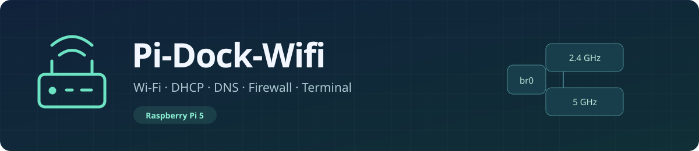
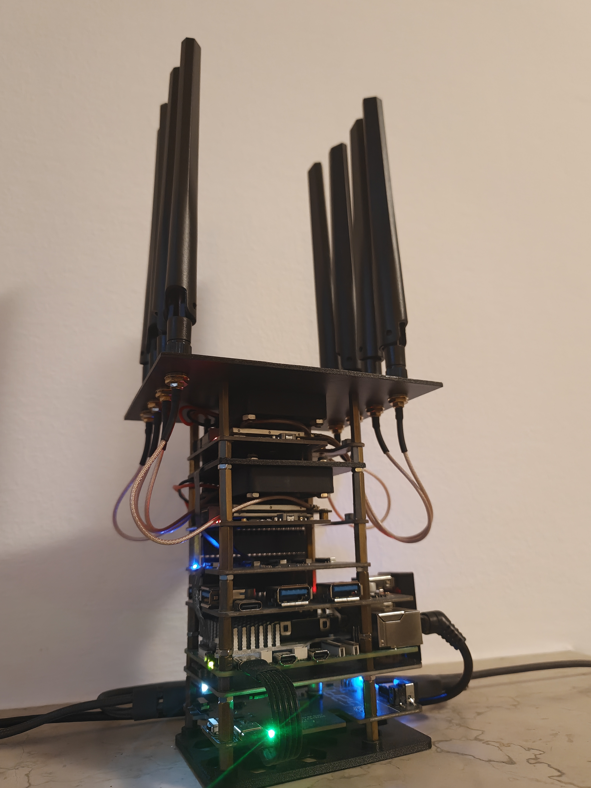
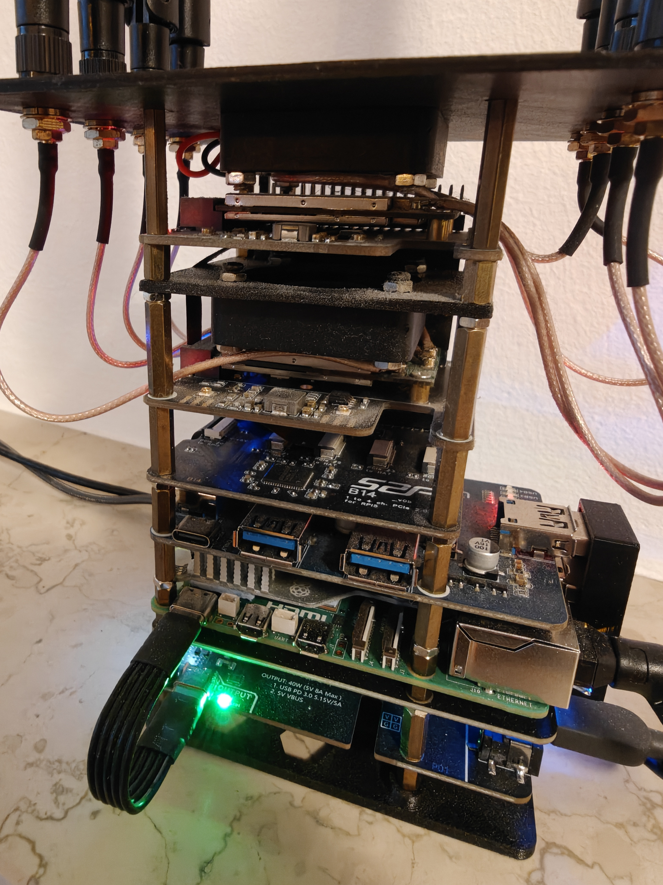
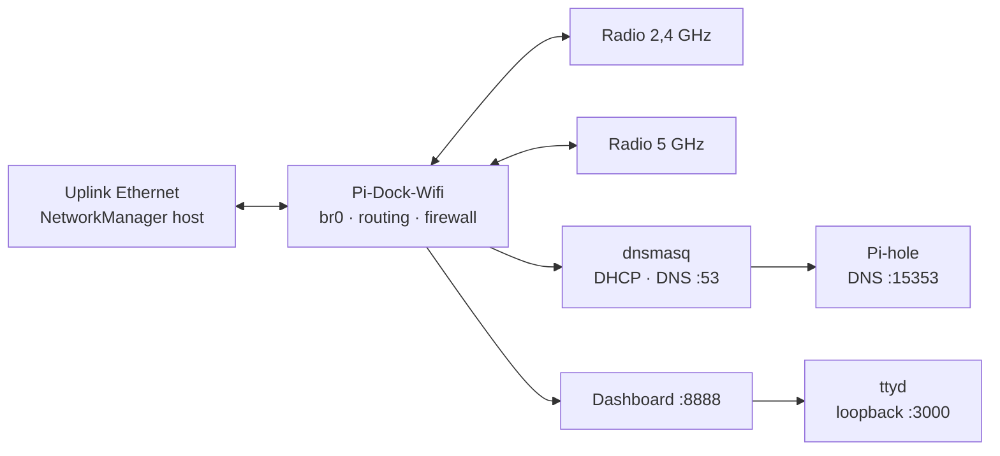

<p align="center">
  
</p>

<p align="center">
  <strong>Italiano</strong> · <a href="README.en.md">English</a><br>
  <a href="docs/it/GUIDA.md">Installazione</a> · <a href="docs/it/HARDWARE.md">Hardware</a> · <a href="docs/it/RETE.md">DHCP e firewall</a>
</p>

# Pi-Dock-Wifi

**Un router Raspberry Pi 5 con configurazioni aperte e controllo diretto della rete.** Due radio Wi-Fi, DHCP/DNS, filtraggio Pi-hole e terminale SSH, gestiti con Docker Compose.

`Raspberry Pi 5` · `Linux ARM64` · `Docker Compose` · `Italiano / English`

## Il router realizzato

<p align="center">
  <a href="docs/assets/router-assembled.jpg"></a>
  <a href="docs/assets/router-hardware-detail.jpg"></a>
</p>

<p align="center"><em>Vista completa e dettaglio del montaggio. Apri le foto per visualizzarle a piena risoluzione.</em></p>

## Cosa puoi controllare

| Radio e client | Rete e sicurezza | Amministrazione |
|---|---|---|
| AP separati 2,4 e 5 GHz | DHCP, prenotazioni e rotte classless | Dashboard autenticata |
| Canale, larghezza, HT/VHT/HE | DNS locale e filtraggio Pi-hole | Terminale SSH con ttyd |
| WPS a pulsante e deny list | NAT, firewall e NetBird | Log, statistiche e recupero Ethernet |

I file restano leggibili e modificabili: puoi adattare la rete, aggiungere regole e usare direttamente gli strumenti Linux. Le configurazioni originali sono conservate, con dati personali sostituiti da esempi e segnaposto.

## Da dove iniziare

| Obiettivo | Guida |
|---|---|
| Preparare e avviare il router | **[Installazione e configurazione](docs/it/GUIDA.md)** |
| Replicare l’hardware e capire `config.txt` | **[Componenti e montaggio](docs/it/HARDWARE.md)** |
| Modificare DHCP, DNS, routing e firewall | **[Rete: file e regole spiegati](docs/it/RETE.md)** |
| Stampare supporti e copertura | **[Quattro STL e tre sorgenti SCAD](hardware/3d)** |

> [!IMPORTANT]
> Lo stack gestisce la rete dell’host: usa un container privilegiato e presuppone un modem/firewall perimetrale a monte. Leggi la guida prima dell’avvio e mantieni accesso locale al Raspberry. Non avviare due copie sullo stesso host.

## Tre servizi, un Compose

| Servizio | Compito | Configurazione |
|---|---|---|
| **pi-dock-wifi** | hostapd, bridge `br0`, dnsmasq, firewall e dashboard | Dockerfile principale + `config/` |
| **pihole** | Filtraggio DNS su `15353`, pannello su `8090` | Immagine ufficiale **2026.10.1** |
| **ttyd** | Terminale SSH attraverso la dashboard | Dockerfile separato in `services/ttyd` |



## Avvio: il percorso breve

1. Verifica l’[hardware e il kernel](docs/it/HARDWARE.md).
2. Copia `.env.example` in `.env`; sostituisci password, SSID e UUID WPS.
3. Configura uplink, directory persistenti e chiave host SSH seguendo la [guida](docs/it/GUIDA.md#3-preparare-lo-stato-persistente).
4. Controlla e avvia:

```sh
docker compose config --quiet
docker compose build
docker compose up -d
```

| Accesso dalla LAN di esempio | Indirizzo |
|---|---|
| Dashboard e terminale | `http://10.42.0.1:8888` |
| Pi-hole | `http://10.42.0.1:8090/admin/` |

La LAN di esempio è `10.42.0.0/24`. Non contiene prenotazioni o credenziali reali; adattala alla tua rete prima di usarla.

## Italiano e inglese

```dotenv
APP_LANGUAGE=it
# Per l’inglese / For English: APP_LANGUAGE=en
```

La scelta riguarda interfaccia, login, messaggi CGI e log degli script, **compresi avvio, healthcheck e recupero Ethernet**. I commenti sono bilingui. Dopo il cambio ricrea i container:

```sh
docker compose up -d --force-recreate
```

Le traduzioni sono già incluse: **non servono Node.js, npm o file `package.json`**. I messaggi nativi dei programmi di terzi mantengono il proprio formato e lo storico dei log non viene riscritto.

## Hardware di riferimento

Pi 5 da 8 GB · **scheda di alimentazione 52Pi P01 / EP-0225** · B14 / ASM1184e · **2× Waveshare MiniPCIe HAT+** · 2× MT7915E · **hub HAT USB 3.2 Gen1 a quattro porte, alimentazione USB-C 5 V** · adattatore N02 e SSD USB-NVMe.

La [distinta completa](docs/it/HARDWARE.md) comprende collegamenti, impostazioni di boot e modelli 3D. Il kernel custom del sistema di riferimento non è distribuito con il progetto.

## Manutenzione e licenza

- [Aggiornare o arrestare lo stack](docs/it/GUIDA.md#aggiornamenti-e-arresto).
- Le configurazioni di rete restano nel repository; dati runtime, password, lease e configurazione Pi-hole restano nell’installazione privata.
- Backup del laboratorio, watchdog UPS e spegnimento controllato non fanno parte di questa distribuzione.
- Licenza **[GPL-3.0](LICENSE)**. Le dipendenze mantengono le [proprie licenze](THIRD_PARTY.md).
